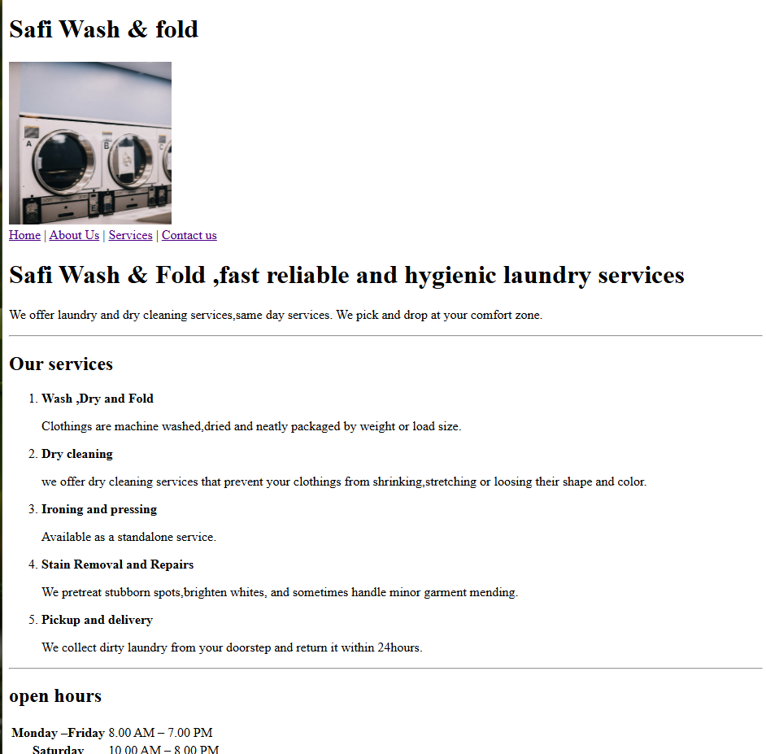

# Safi Wash & Fold

> Safi Wash & Fold ,fast reliable and hygienic laundry services


**Safi wash & fold** is an Online system for laundry services, drop off or request doorstep pickup & delivery.

**Live Site** | https://ogwenoirene.github.io/Safi-Wash-Fold



### Technologies Used

```bash
Html5
```

### Setup Instructions

- Open gitbash
- Change directory to Desktop
 ```bash 
 cd Desktop/

 ```
- Clone the project from Github

```bash
git clone  https://ogwenoirene.github.io/Safi-Wash-Fold
```
- Change directory to `Safi-Wash-Fold` project

 ```bash 
 cd Safi-Wash-Fold/

 ```
- Open in vs code

```bash 
code .
```
- Once in vscode,right-click  on `index.html`  file and choose ***Open with Live Server***

### Business Rationale
The Safi Wash and Fold website was designed to give customers an easy and convenient way to access laundry services. The website uses a clean, modern, and user-friendly layout to help customers find information quickly.
- Easy navigation: Helps customers find services and contact information easily.
- Service descriptions: Helps customers understand the laundry services offered.
- Contact section: Makes it easier for customers to reach the business and make enquiries.
- Responsive design: Allows customers to access the website using phones, tablets, and computers.
- Overall goal: To increase customer awareness, attract more customers, build trust, and grow Safi Wash and Fold's business.